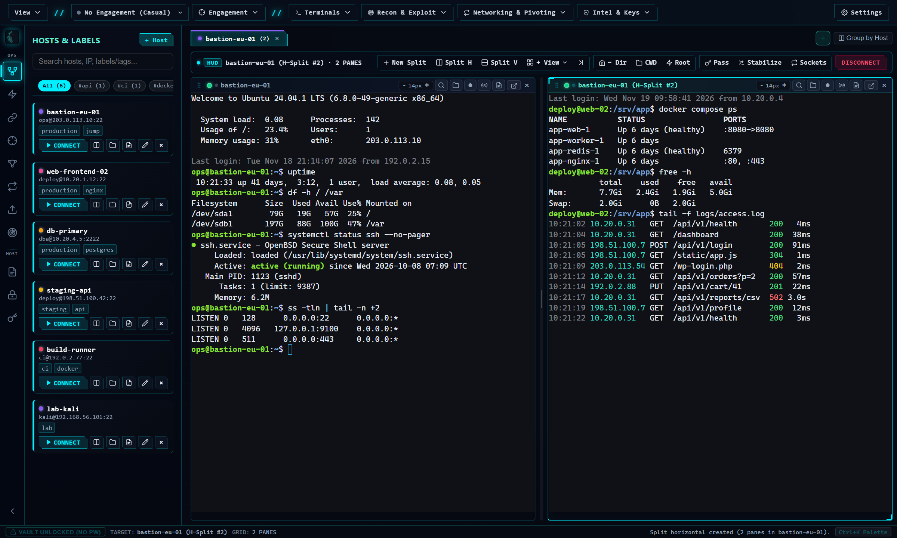
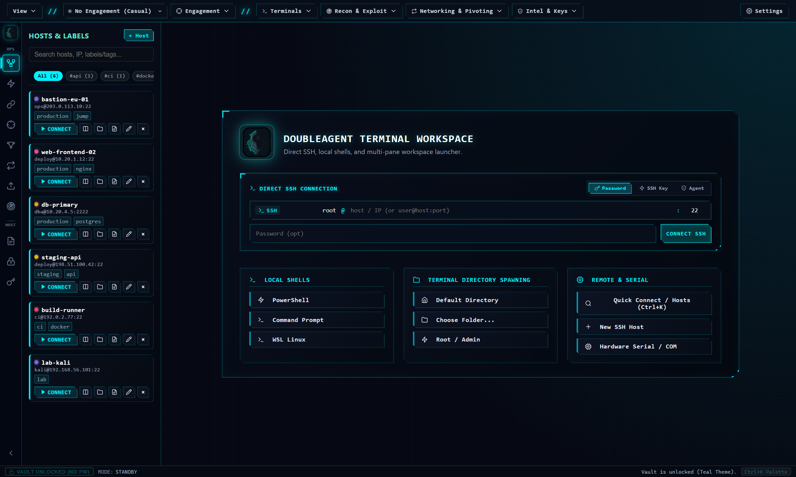
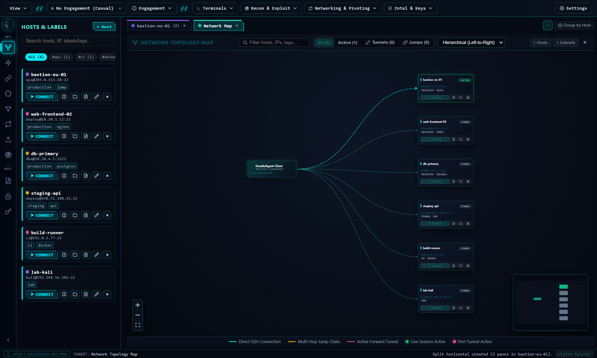
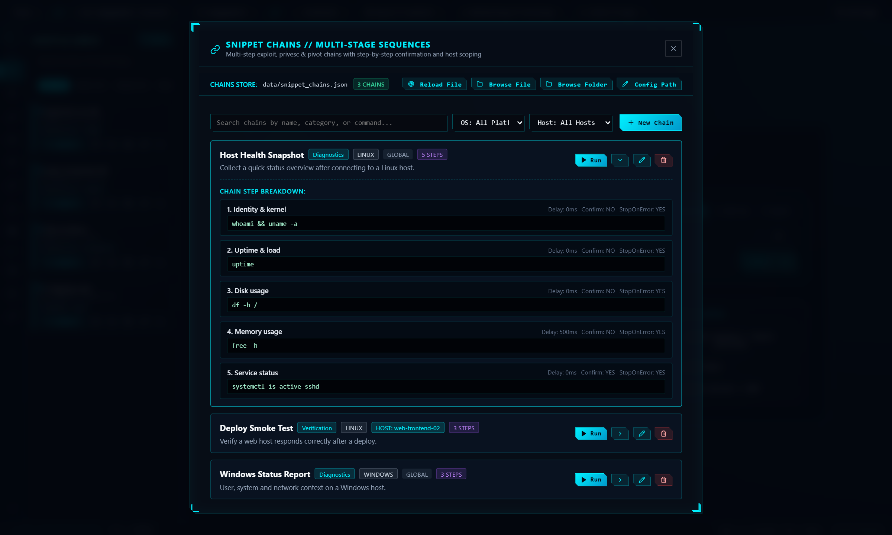
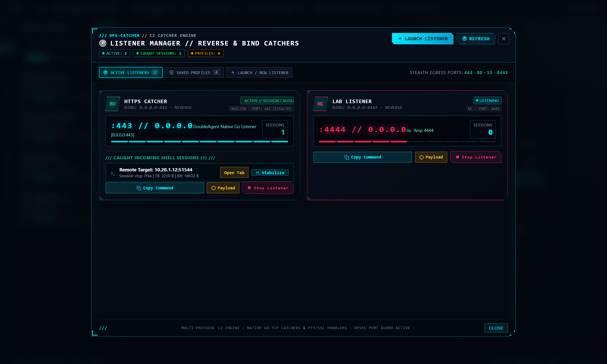
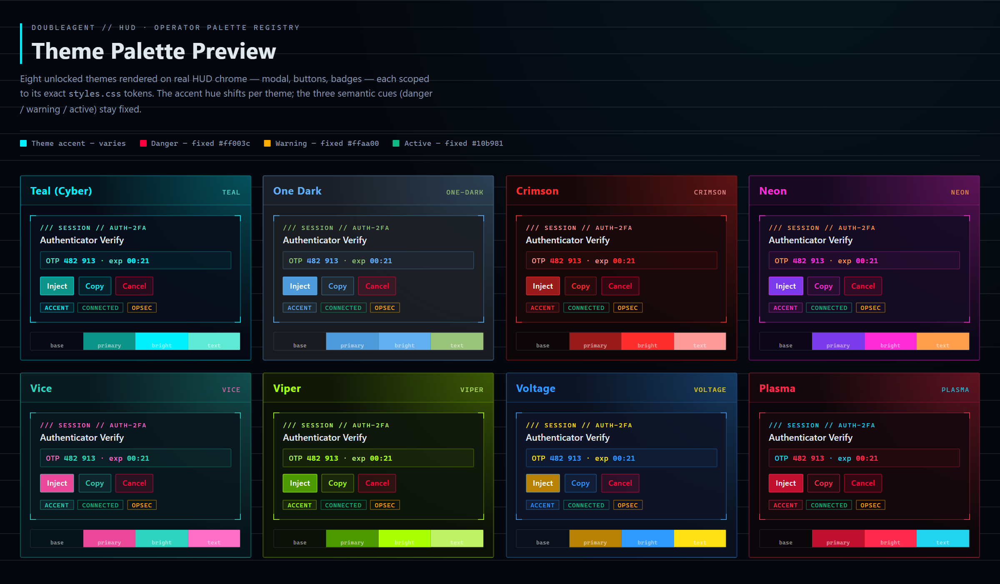

<p align="center">
  
</p>

# DoubleAgent

DoubleAgent is a modern, lean, cross-platform (Windows + Linux) native **SSH client** built with **Wails v2** (Go backend) and **React + TypeScript + xterm.js** (frontend in the system WebView).

- **Operating Manual**: [AGENTS.md](./AGENTS.md)
- **Canonical Specification**: [docs/SPEC.md](./docs/SPEC.md)
- **Current Project State**: [docs/tech/STATE.md](./docs/tech/STATE.md)
- **Technical Documentation**: [docs/tech/README.md](./docs/tech/README.md)
- **User Handbook**: [docs/handbook/README.md](./docs/handbook/README.md)
- **Architecture Decision Records**: [docs/adr/](./docs/adr/)

## Screenshots

> All hosts, addresses and terminal output below are dummy data.



| Hosts & launcher | Network topology map |
| --- | --- |
|  |  |

| Exploit / snippet chains | Listener manager |
| --- | --- |
|  |  |

### Color themes



## Features

Feature IDs (F-xx) trace to [docs/SPEC.md](./docs/SPEC.md) and the pentest-module spec.

### SSH client

- **Hosts & groups** (F-01) — host address, port and identity; groups inherit port, user and keepalive, and per-host values override the group.
- **Command Palette / Quick Connect** (F-02) — Ctrl+K fuzzy search over name, address and tags; connect to `user@host:port` directly.
- **Encrypted vault** (F-03) — everything secret encrypted on disk; app starts locked; auto-lock after a configurable idle time.
- **Keychain** (F-04) — generate Ed25519/RSA keys; import OpenSSH and PuTTY `.ppk`; copy the public key with one click.
- **Agent integration** (F-05) — authenticate via the Windows OpenSSH agent and Pageant without keeping the key in the vault.
- **Known hosts** (F-06) — first connection shows the SHA256 fingerprint; a changed host key blocks with a clear warning.
- **Terminal** (F-07) — xterm.js; vim, tmux, htop and mc work cleanly; truecolor; resize and large output never freeze the UI.
- **Tabs & split panes** (F-08) — split horizontally/vertically, reorder tabs by drag, move focus by keyboard.
- **Tab groups by host** (F-09) — a host's sessions in one collapsible, color-coded group.
- **New terminal in a directory** (F-10) — open in the default directory, the current directory, or as root in the current directory.
- **Scrollback & search** (F-11) — 10,000+ configurable lines; regex search with highlighting.
- **SFTP browser** (F-12) — dual-pane local/remote, drag-and-drop, transfer queue with progress and cancel.
- **Port forwarding** (F-13) — save `-L`, `-R` and `-D` rules; status visible; optionally start with the host.
- **Proxy profiles** (F-14) — ProxyJump/ProxyCommand per host; export a proxychains config.
- **Snippets** (F-15) — commands with `{{VAR}}` variables prompted before sending.
- **Host notes** (F-17) — folders and sub-pages per host, Markdown, searchable.
- **TOTP generator** (F-20) — a TOTP secret per host/service, code with countdown, insert at a 2FA prompt.
- **Session logging** (F-21) — per-session transcript with timestamps, toggled per host; password echo is never recorded.
- **ssh_config import** (F-22) — Host, HostName, User, Port, IdentityFile and ProxyJump imported; unknown directives reported.
- **Local terminals** (F-23) — PowerShell, cmd and WSL/bash/zsh as tabs over a PTY.
- **Jump chains** (F-25) — chains of 3+ hops, each hop with its own identity.
- **Broadcast input** (F-26) — type into several selected sessions at once, clearly marked.
- **Auto-reconnect & restore** (F-27) — reconnect with backoff; tabs and split layout restored after restart.
- **Remote edit** (F-28) — edit a remote file in a local editor; save uploads it; concurrent edits are detected.
- **Vault file sync** (F-29) — vault over Google Drive/Syncthing with conflict detection and merge.
- **PuTTY / Termius import** (F-30) — import hosts, keys, groups and tunnels from PuTTY and Termius.
- **Network map** (F-37) — hosts, subnets and configured tunnels/jumps as a react-flow graph.

### Pentesting module

> Built on top of the core client; general-purpose SSH use never requires it.

- **Snippet / exploit chains** (F-16) — multi-stage command chains with per-step confirmation by default, stop-on-error, and host scoping.
- **Evidence vault** (F-18) — categories with free-text or table entries, pre-filled with common findings.
- **Save selection** (F-19) — send a terminal selection to the vault as a credential or evidence, auto-assigned to the active session's host.
- **Credential store & spray lists** (F-36) — an engagement-wide credential pool; export as user list, password list, `user:pass` or cross-product; single-password-many-users mode.
- **Lockout protection** (F-40) — a lockout policy per engagement and a warning before a spray action would breach it.
- **Shell stabilization** (F-34) — one-click upgrade of a raw shell: PTY (python/script/socat), `stty raw`/echo, TERM and window size; Windows via ConPtyShell.
- **File transfer helper** — start a quick HTTP server (python/updog) and generate the per-OS download command (curl, wget, certutil, SMB) with hash check.
- **Raw TCP client & listener** — line-buffered raw-TCP client with local echo plus an inbound TCP listener to catch reverse shells into a terminal tab.
- **nmap import** (F-39) — import and parse nmap XML (`-oX`); map hosts, ports, services, versions and NSE results into per-port note pages.
- **Pivoting** (F-24) — start/stop ligolo-ng / chisel pivots from the UI with routes, listeners and live status.
- **Route health check** (F-38) — throttled, OPSEC-aware probes to check whether a route/tunnel is live and what is reachable.
- **Listener manager** (F-32) — start and manage reverse/bind listeners (nc, rlwrap, ncat --ssl, socat PTY) with status, port and incoming sessions.
- **Payload generator** (F-33) — reverse/bind payloads from templates (bash, python, PowerShell, socat); fill LHOST/LPORT; copy or save as a snippet.
- **API tester & HTTP repeater** (F-42) — Go-backed structured/raw HTTP client with SOCKS5/pivot routing, vault secret injection, environments, inspector/diff, throttled parameter replay, hex body mode, evidence export and an AI chat mode.
- **Binary / hex payload runner** (F-43) — non-PTY `os/exec` / SSH-exec raw-byte runner for arbitrary hex payloads, with a hex/ASCII/Base64 dump viewer and an API/raw-TCP bridge.
- **WebSocket client** (F-44) — persistent `ws://`/`wss://` sessions with SOCKS5/pivot routing, vault secrets, text and binary/hex frames, and a live frame log.
- **Remote socket discovery & 1-click -L tunnel** (F-45) — on-demand non-PTY discovery of listening sockets (Linux + Windows), loopback highlighting and one-click `-L` forwarding into the API tester.
- **Ephemeral Remote Companion Agent** (F-46) — auto-deployed, zero-port headless Linux Go worker (`doubleagent-agent`) over SSH `stdin`/`stdout` so you can run the native Windows UI (keeping Vault/Notes/Evidence local) while executing Linux PTY shells, directories, `LHOST`, listeners, HTTP staging servers, pivots, context-routed SSH, and context-bound port forwards on Kali.
- **WinRM / PowerShell remoting** (F-41) — direct WinRM execution (HTTP 5985 / HTTPS 5986; NTLM/Kerberos/Basic; Evil-WinRM parity) with command execution and file transfer.
- **Reporting export** — export the evidence vault per host as Markdown/HTML.

## Repository Layout

```text
.
├── main.go                 # Wails application entrypoint & embedded frontend assets
├── app.go                  # Bound Go application struct (minimal frontend-facing surface)
├── wails.json              # Wails v2 project configuration
├── backend/
│   ├── core/               # Domain models & strict boundary interfaces (SshTransport, TerminalEngine, SecretStore)
│   ├── ssh/                # SSH transport implementation (golang.org/x/crypto/ssh + pkg/sftp)
│   ├── pty/                # Local PTY implementation (ConPTY on Windows, creack/pty on Unix)
│   ├── vault/              # Encrypted vault implementation (Argon2id + XChaCha20-Poly1305)
│   └── data/               # Non-secret settings, workspace state, optional pure-Go SQLite history
├── frontend/               # React + TypeScript + Vite + xterm.js UI
├── build/                  # Packaging configuration and compiled standalone binaries (build/bin/)
└── docs/
    ├── SPEC.md             # Canonical Core Specification
    ├── adr/                # Architecture Decision Records
    ├── handbook/           # User-facing documentation
    ├── spikes/             # Technical spike reports
    └── tech/               # Developer & architectural documentation (including STATE.md)
```

Dependencies point **downwards only**:
- `frontend` → explicitly bound Go methods on `App`
- `backend/{ssh,pty,vault,data}` → `backend/core` (the interfaces)
- `backend/core` imports no external SSH, PTY, or crypto packages and is unit-testable in isolation.

## Commands

```bash
wails dev                         # Renderer + native app window with hot reload
./scripts/build-all.ps1           # Windows host: verify Windows+Linux Go, test, build Windows + Linux (via Docker/WSL)
./scripts/build-all.sh            # Linux host: verify, test, build Linux + cross-build Windows binary
wails build                       # Single-OS standalone binary → build/bin/
go test ./...                     # Run backend unit tests
go vet ./... && golangci-lint run
cd frontend && npm run test       # Run frontend unit tests (Vitest)
cd frontend && npm run build      # Typecheck and bundle frontend assets
```

### Building for Both Windows & Linux

- **Output binaries** (written to `build/bin/`):
  - Windows (`amd64`): `build/bin/DoubleAgent.exe`
  - Linux (`amd64`): `build/bin/DoubleAgent-linux-amd64` (desktop entry in `build/linux/doubleagent.desktop`)
  - Headless Remote Companion Agent (`F-46`, keep alongside `DoubleAgent.exe` / `DoubleAgent-linux-amd64`):
    - `build/bin/doubleagent-agent-linux-amd64`
    - `build/bin/doubleagent-agent-linux-arm64`
  - To build only the headless agents manually from any OS (pure Go, `CGO_ENABLED=0`, no Docker/WSL needed):
    ```bash
    CGO_ENABLED=0 GOOS=linux GOARCH=amd64 go build -o build/bin/doubleagent-agent-linux-amd64 ./cmd/doubleagent-agent
    CGO_ENABLED=0 GOOS=linux GOARCH=arm64 go build -o build/bin/doubleagent-agent-linux-arm64 ./cmd/doubleagent-agent
    ```
    *(Both `./scripts/build-all.ps1`, `./scripts/build-all.sh`, and GitHub Actions CI build these automatically.)*
- **On Linux (Ubuntu 24.04 / Debian 12+ / Kali / Arch):**
  ```bash
  sudo apt-get update && sudo apt-get install -y build-essential pkg-config libgtk-3-dev libwebkit2gtk-4.1-dev
  ./scripts/build-all.sh
  ./scripts/install-linux.sh        # Installs global `doubleagent` command + app launcher icon (or `--user` for ~/.local/bin)
  ```
  `scripts/build-all.sh` auto-detects `webkit2gtk-4.1` (`-tags webkit2_41`) vs `webkit2gtk-4.0`, builds `DoubleAgent-linux-amd64`, and cross-compiles `DoubleAgent.exe` in one step. After installing, launch from any terminal via `doubleagent` (remove anytime with `./scripts/install-linux.sh --uninstall`).
- **On Windows:**
  ```powershell
  ./scripts/build-all.ps1
  ```
  Always cross-checks `GOOS=linux GOARCH=amd64` Go vet/build, builds `DoubleAgent.exe`, and builds `DoubleAgent-linux-amd64` automatically when **Docker Desktop** (`Dockerfile.linux-build`) or **WSL2** (with GTK3 + WebKit2GTK) is installed. *(Wails v2 Linux GUI binaries link against GTK3/WebKit2GTK via CGo, so a Linux userspace via Docker, WSL2, a Linux host, or GitHub Actions CI is required for linking the Linux binary.)*
- **GitHub Actions CI (`.github/workflows/ci.yml`):** Automatically tests and builds both `DoubleAgent-Windows` and `DoubleAgent-Linux` binaries on every push and pull request.

